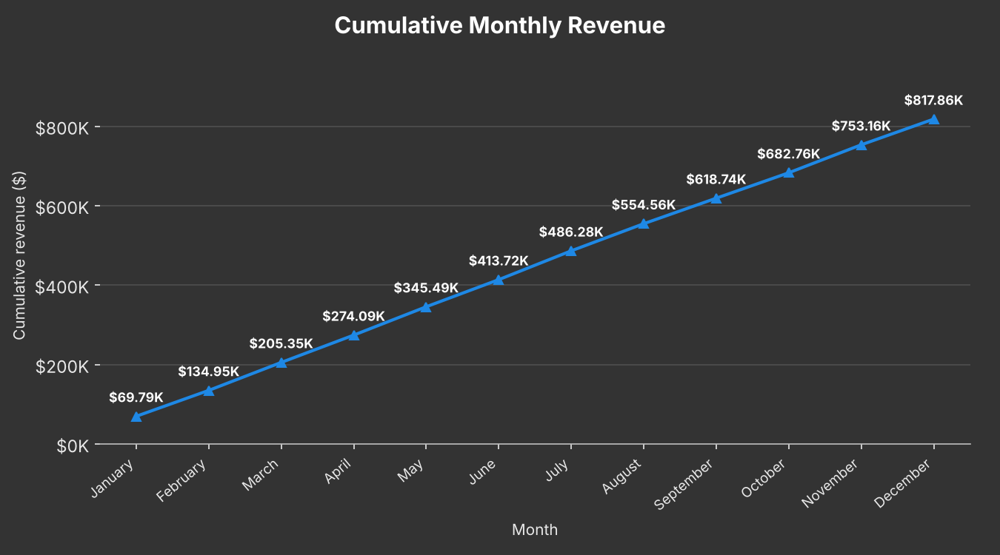
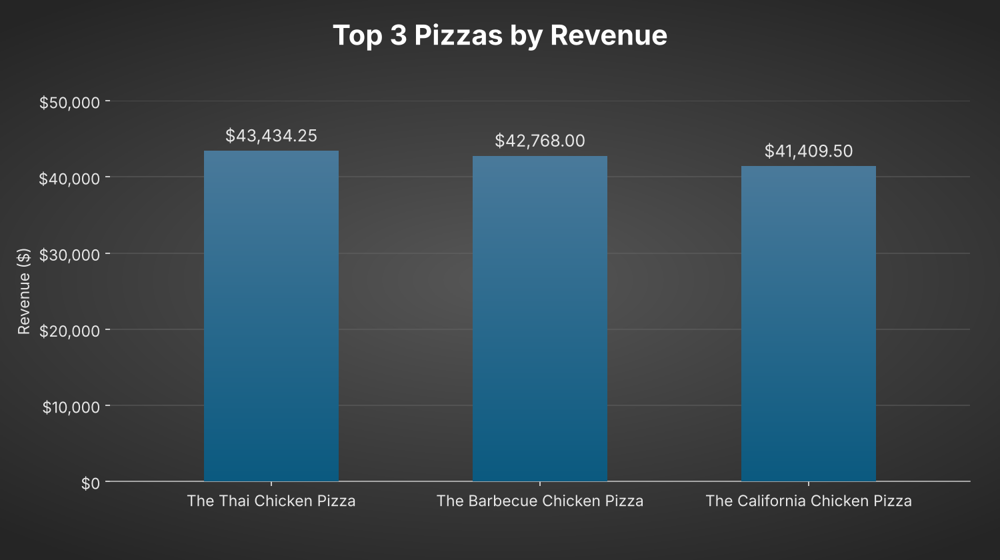
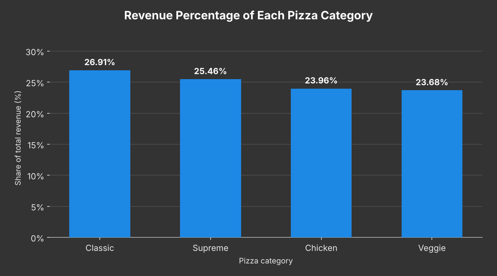
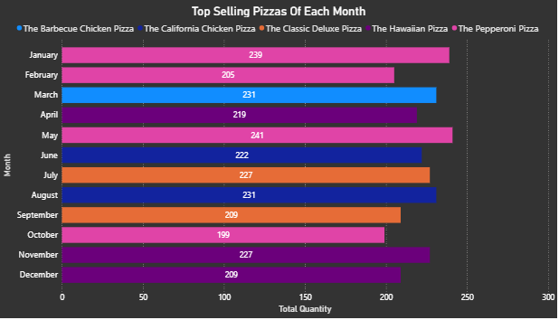
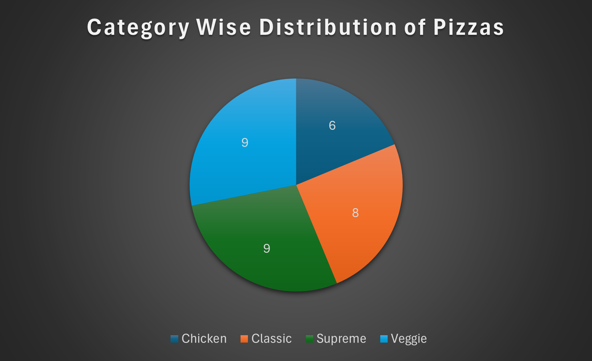
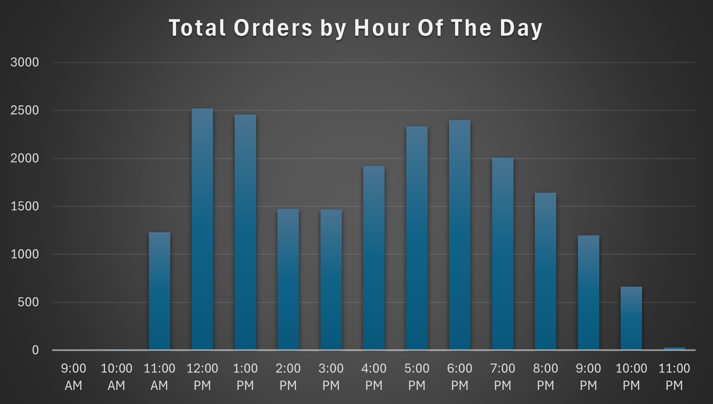
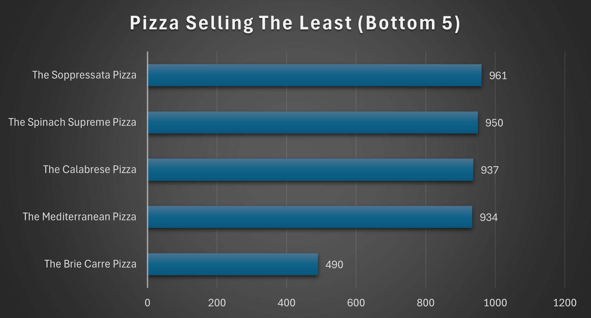

<!-- HEADER -->
<h1 align="center">🍕 <strong>Pizza Sales SQL Analysis</strong></h1>

<em>A SQL-based sales analysis using MySQL, CTEs & Window Functions</em>

  
  
  
  

---

## 📘 **Project Overview**

This project analyses a year of pizza sales data (January to December 2015) in MySQL to find which pizzas, categories and times of day drive revenue. I wrote 16 queries using joins, aggregations, CTEs and window functions (RANK and cumulative sums), and presented the results with charts and a Canva presentation.

**Business question:** What sells, when does it sell, and where does the revenue come from, so a pizza retailer can make better menu and staffing decisions?

---

## 🔎 **Key Findings**

- **21,350 orders** generated **$817,860.05** in revenue. Monthly revenue was stable, from $64,027.60 (October) to $72,557.90 (July).
- **Classic** is the strongest category: the most pizzas sold (**14,888**) and the highest revenue share (**26.91%**). Supreme is second (11,987 pizzas, 25.46%).
- **Chicken** earns more than its size suggests. It has the fewest pizza types on the menu (6) and the lowest quantity (11,050), yet its pizzas take the **top 3 revenue spots**: Thai Chicken ($43,434.25), Barbecue Chicken ($42,768.00) and California Chicken ($41,409.50).
- Revenue is spread fairly evenly across categories, between **23.68% and 26.91%**.
- Orders peak at **lunch (12 PM: 2,520 and 1 PM: 2,455)** and **early evening (5 PM: 2,336 and 6 PM: 2,399)**, with a dip in the mid-afternoon (about 1,470 orders at 2 PM and 3 PM).
- **Large** is the most common pizza size, and **The Greek Pizza** is the highest-priced.
- The top 5 pizzas by quantity are Classic Deluxe, Barbecue Chicken, Hawaiian, Pepperoni and Thai Chicken. Pepperoni was the monthly top seller in 4 months, Hawaiian in 3.
- **The Brie Carre Pizza** sells the least (**490**), about half of the next-lowest pizzas (Mediterranean 934, Calabrese 937, Spinach Supreme 950, Soppressata 961).

---

## ✅ **Recommendations**

- Staff and prepare for the 12-1 PM and 5-6 PM peaks, and consider an offer to lift the mid-afternoon dip.
- Promote the Chicken pizzas, especially Thai Chicken, since they earn the most revenue.
- Review the bottom 5 pizzas, starting with Brie Carre: promote it or consider replacing it.
- Keep a balanced menu, since no single category dominates revenue.

---

## ⚙️ **Process**

1. Downloaded the dataset and validated the CSV files in Excel (missing values, duplicates); the data was clean.
2. Imported the data into MySQL and checked the data types, changing them where needed.
3. Wrote 16 analytical queries using joins, aggregations, CTEs and window functions.
4. Built charts from the query results in Excel and Power BI.
5. Presented the findings in a Canva presentation.

**Dataset structure:** four tables (`orders`, `order_details`, `pizzas`, `pizza_types`), linked through `order_id`, `pizza_id` and `pizza_type_id`.

---

## 🔍 **Analyses Performed**

### 📦 Sales & Revenue
- Total orders  
- Total revenue  
- Highest-priced pizza  
- Most common pizza size  

### 📊 Product Performance
- Top 5 best-selling pizzas  
- Top 3 pizzas by revenue  
- Least-selling pizzas  

### 🧠 Advanced Analytics
- Revenue contribution by category  
- Category-wise distribution of pizzas  
- Monthly cumulative revenue (CTE + Window Functions)  
- Top-selling pizza of each month (RANK)  
- Daily averages & hourly order patterns  

---

## 🛠️ **Tech Stack**

| Tool / Concept | Purpose |
|----------------|---------|
| **MySQL** | Querying, KPI extraction, analysis |
| **CTEs (WITH)** | Modular & organized SQL |
| **Window Functions** | Ranking, cumulative metrics, trends |
| **Joins & Aggregations** | Data merging & KPI calculations |
| **Excel & Power BI** | Creating charts & storytelling |
| **Canva** | Final project presentation |

---

## 📂 **Download All SQL Queries**

📥 [**Queries.zip**](https://github.com/user-attachments/files/24082892/Queries.zip)

Contains all 16 SQL analytical queries.

---

## 📈 **Data Visualizations**

### ⭐ **Cumulative Monthly Revenue**

### ⭐ **Top 3 Pizzas by Revenue**

### ⭐ **Revenue % by Pizza Category**

### ⭐ **Top-Selling Pizza of Each Month**

### ⭐ **Number of Pizza Types per Category**

### ⭐ **Orders by Hour of the Day**

### ⭐ **Bottom 5 Least-Selling Pizzas**

---

## 🎥 **Project Presentation**

📄 [**Pizza Sales Dashboard.pdf**](https://github.com/user-attachments/files/24082525/Pizza.sales.dashboard.pdf)

KPI summaries, visual insights and the story behind the findings.

---

## ⚠️ **Limitations**

- The findings come from one year of sales in a single dataset.
- The analysis covers orders by pizza, category, month and hour of the day, not individual customers.
- Findings describe this dataset only and are not forecasts.

---

## 📬 **Contact**

**📌 Kashaf Naz**  
🔗 LinkedIn: [linkedin.com/in/kashaf-naz](https://linkedin.com/in/kashaf-naz)  
🐙 GitHub: [github.com/Kashaf-naz](https://github.com/Kashaf-naz)
